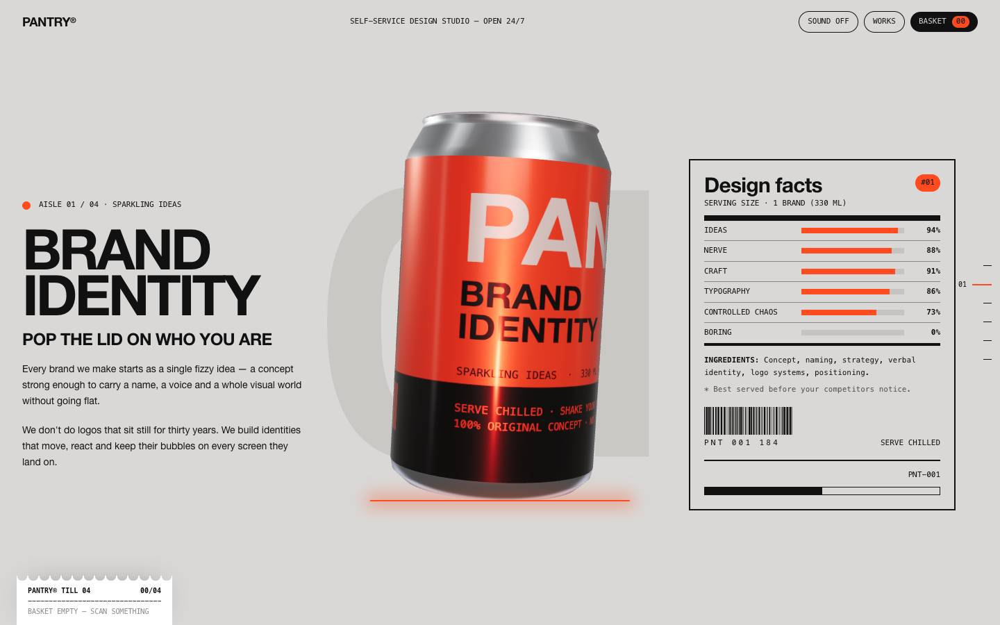
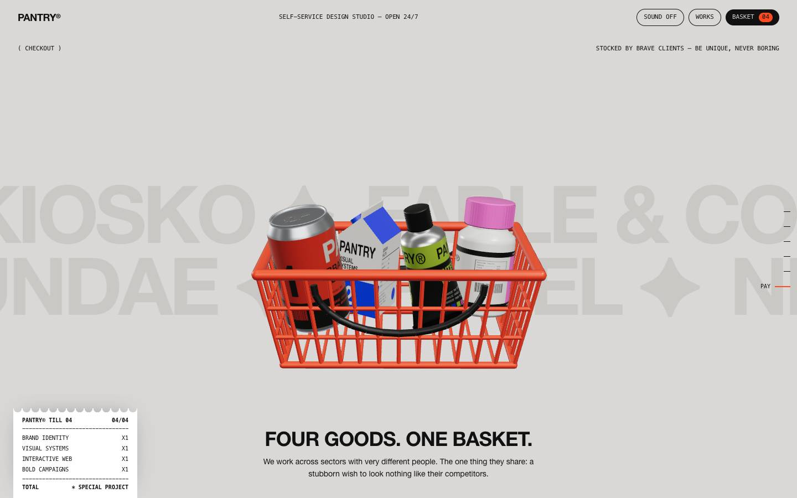

# PANTRY® — 3D scroll storytelling site

A single-page site for a fictional design studio that sells its services as packaged goods.
Scrolling tells a small shopping story: each product comes on stage, gets scanned, is stamped
"Purchased" and flies into the basket, a till receipt prints line by line, and at checkout all
four products drop into a 3D basket.




## Stack

- React 19 + Vite + TypeScript
- Three.js (plain, no react-three-fiber)
- Tailwind CSS v4
- Lenis for smooth scrolling

## No 3D assets

Every model is built in code (`src/components/products.ts`): the can, carton, tube, bottle and
basket are lathe / extrude / parametric geometry, and the labels are drawn on a canvas and used
as textures. The studio lighting is a generated environment map, so the repo ships no `.glb`,
image or HDR files.

## Structure

| File | What it does |
| --- | --- |
| `src/components/Site.tsx` | Page sections, scan state, receipt, chapter rail |
| `src/components/Scene.tsx` | WebGL layer; scroll-pinned poses for the five objects |
| `src/components/products.ts` | Procedural models, label textures, environment |
| `src/components/content.ts` | All copy (services, clients, works) |
| `src/components/story.ts` | Shared timing of the scan beat |

## Run

```bash
npm install
npm run dev      # local dev server
npm run build    # type-check and build to dist/
npm run preview  # serve the build
```

Brand, copy, client names and e-mail address are placeholders.
